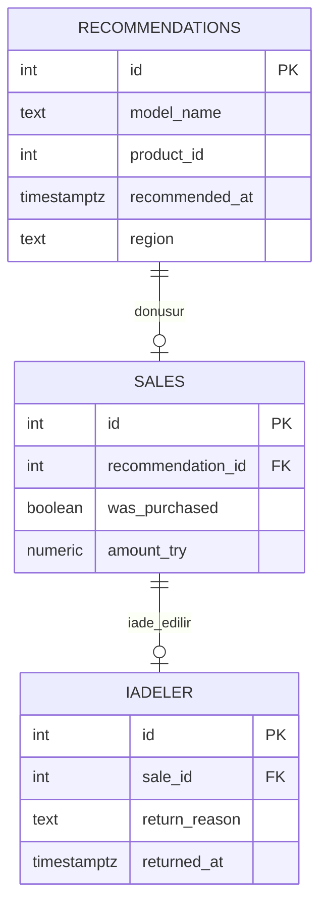

# Tarım × Öneri Motoru × Model Performans Karşılaştırması (Kura #21)

Bu depo, BLP 1005 Veritabanı Yönetim Sistemleri dersi kapsamında çiftçilerin tarla ve iklim koşullarına (`N`, `P`, `K`, `temperature`, `humidity`, `ph`, `rainfall`) göre tarımsal girdi öneren iki farklı makine öğrenmesi modelinin (`Model A` ve `Model B`) satın alma dönüşümü ve iade oranlarını karşılaştırmak üzere geliştirilmiştir.

## Veri Modeli

### 1. Varlık-İlişki Diyagramı (ERD)



> **İlişki Özeti:**
> - **`recommendations` → `sales` (`1 : 0..1`):** Üretilen her önerinin en fazla bir satış değerlendirme kaydı bulunur; henüz satış aşamasına geçmemiş 168 öneri için `sales` tablosunda satır yer almaz.
> - **`sales` → `iadeler` (`1 : 0..1`):** Gerçekleşen her satış en fazla bir kez iade edilebilir; iade edilmeyen satışlar için `iadeler` tablosunda kayıt oluşturulmaz (eksik veri değil, sorunsuz tamamlanan satıştır).

### 2. Normalizasyon Notu (3NF Değerlendirmesi)

Tasarlanan şema **Üçüncü Normal Form (3NF)** kurallarına uygundur:
- **1NF (Atomik Değerler ve Tekrarlayan Grupların Önlenmesi):** Her tablodaki tüm sütunlar tekil ve atomik değerler taşır (`model_name`, `region`, `amount_try`, `return_reason`); aynı hücrede birden fazla ürün veya iade nedeni tutulmaz.
- **2NF (Kısmi Bağımlılığın Önlenmesi):** Üç tabloda da tek sütunlu yapay birincil anahtar (`id`) kullanıldığı için anahtar dışı tüm nitelikler birincil anahtarın tamamına tam bağımlıdır.
- **3NF (Geçişli Bağımlılığın Önlenmesi):** Satış tutarı (`amount_try`) yalnızca satış kaydına (`sales.id`), iade nedeni ve tarihi (`return_reason`, `returned_at`) yalnızca iade kaydına (`iadeler.id`) bağlıdır. İade bilgileri `sales` tablosuna gömülmediği için iade edilmeyen binlerce satırda gereksiz `NULL` tekrarı engellenmiş, `recommendations` bilgileri de `sales` içine kopyalanmadığı için güncelleme anomalilerinin önüne geçilmiştir.

### 3. Örnek Analiz Sorguları (JOIN)

#### Sorgu 1: Henüz Satış Kaydı Oluşmamış Önerilerin Modellere Göre Dağılımı (`LEFT JOIN`)
*Soru: Öneri motoru tarafından üretildiği halde `sales` tablosuna hiç yansımamış (satış aşamasına geçmemiş) önerilerin modellere ve bölgelere göre dağılımı nedir?*

```sql
SELECT
    r.model_name,
    r.region,
    COUNT(r.id) AS unrecorded_recommendation_count
FROM recommendations r
LEFT JOIN sales s ON r.id = s.recommendation_id
WHERE s.id IS NULL
GROUP BY r.model_name, r.region
ORDER BY r.model_name, unrecorded_recommendation_count DESC;
```

#### Sorgu 2: Model A ve Model B'nin Satın Alma ve İade Performans Karşılaştırması (`LEFT JOIN`)
*Soru: İki modelin toplam öneri sayısı, gerçekleşen satın alma sayısı, iade edilen ürün sayısı ve toplam ciro (`TRY`) bazında performansı nasıldır?*

```sql
SELECT
    r.model_name,